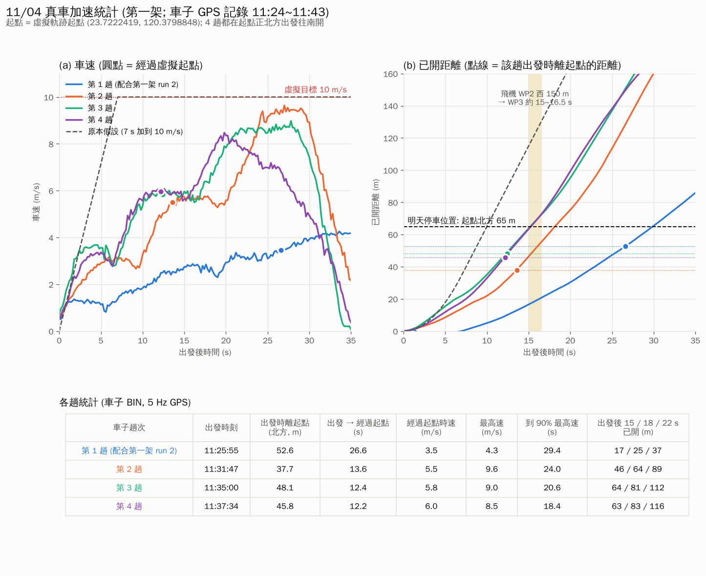
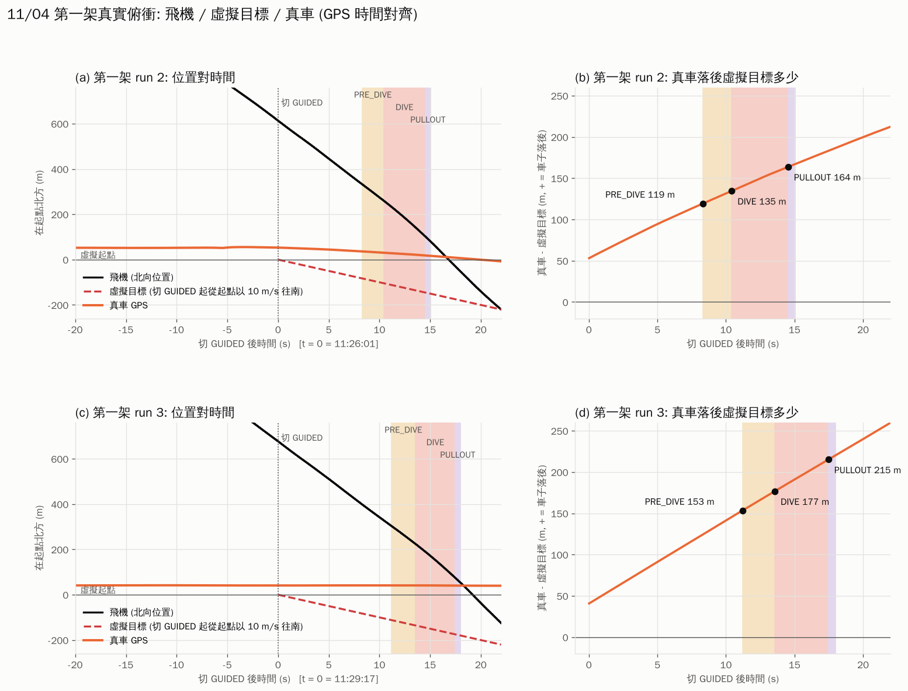
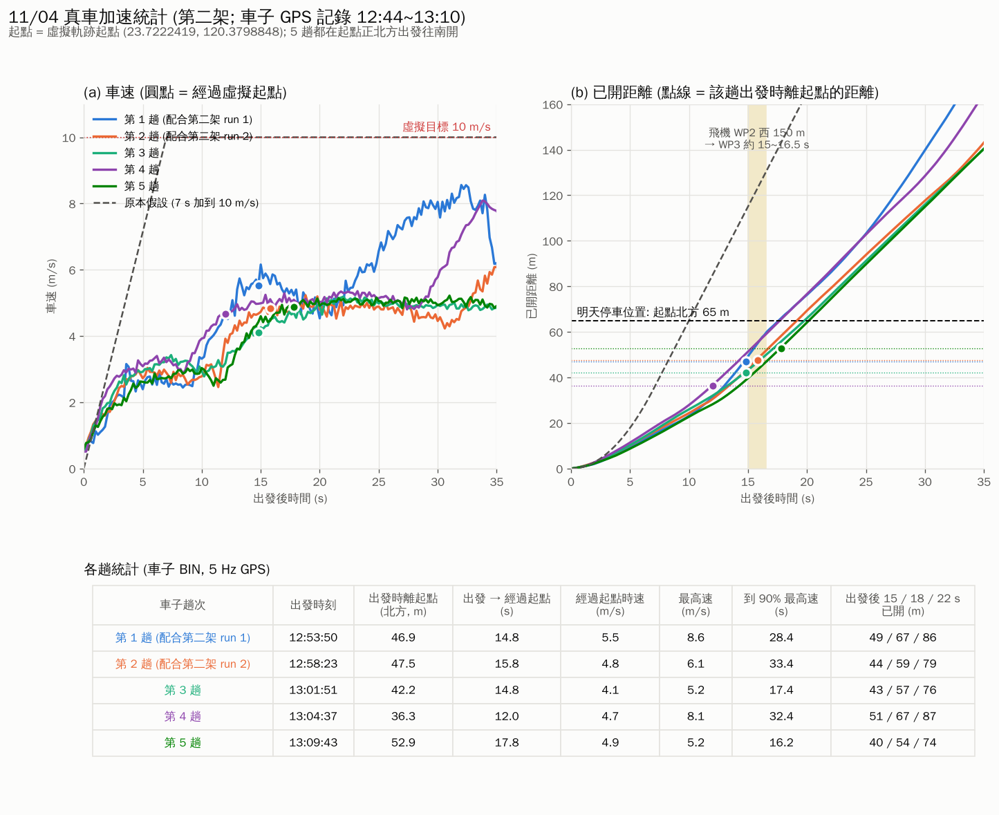
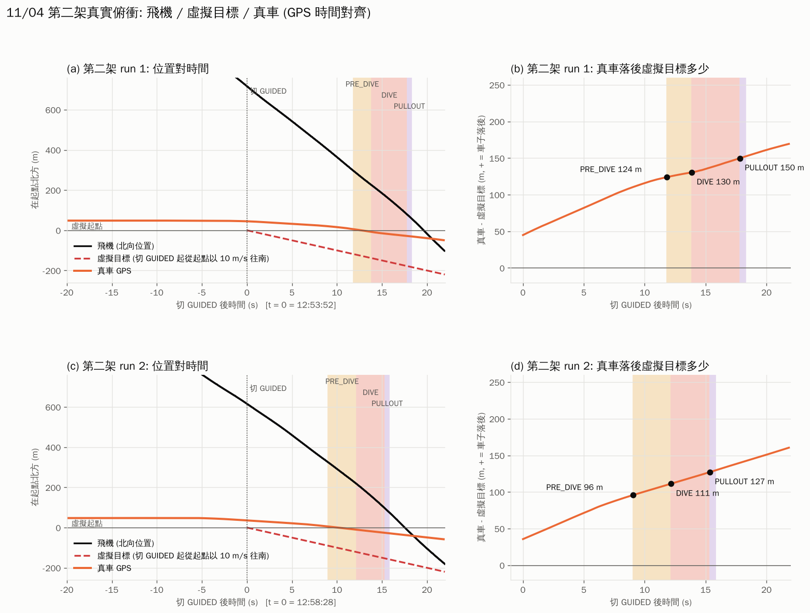

# X-wing 11/04 實飛

## 俯衝成績
| 飛機 | 趟次 | 切 GUIDED 離起點 | miss | 沿航跡 / 側向 | γ (GPS) | 拉平後最低 |
|---|---|---|---|---|---|---|
| 第一架 | run 2 | 614 m | 28.0 m | -4.5 / +27.6 m | -26.7° | 104 m |
| 第一架 | run 3 | 677 m | 29.0 m | -22.0 / +18.9 m | -26.7° | 106 m |
| 第二架 | run 1 | 716 m | 61.7 m | -57.4 / -22.7 m | -29.9° | 114 m |
| 第二架 | run 2 | 616 m | 26.2 m | +3.4 / -26.0 m | -25.4° | 111 m |

雲台: 兩架每趟 GUIDED 都 100% 連線, TRACK / LOCK 都在 0.3 s 內確認, 鎖到 -28~-30° 約 0.8~1.4 s; 偵測率 0%.
第二架: 彈射與落地瞬間我們這端 USB-UART 斷開 1 s (自動重開); 空中 12:53 對方程式重啟 (39 s).

## 真車: 第一架 (車子 BIN 11:24~11:43)



- 車子加速很慢: 0~15 s 只有 3~6 m/s, 約 18~24 s 才到 8.5~9.6 m/s; 全力開時 15 / 18 / 22 s 已開 46~64 / 64~83 / 89~116 m.
- 第一架 run 2: 車子在切 GUIDED 前 6.6 s 才出發, 且開很慢 (最高約 4.5 m/s), 推頭時落後虛擬目標 119 m, DIVE 開始 135 m.
- 第一架 run 3: 車子停在起點北方約 41 m 沒有開, 推頭時落後 153 m.

## 真車: 第二架 (車子 GPS 12:44~13:10, car_gps_extract.py 抽出)



- 5 趟都在起點北方 36~53 m 出發; 經過起點花 12~18 s, 時速只有 4.1~5.5 m/s; 15 s 內只有 3~5.7 m/s.
- 第二架 run 1: 車子在切 GUIDED 前 2 s 出發, 推頭時落後 124 m, DIVE 開始 130 m.
- 第二架 run 2: 車子在切 GUIDED 前 5 s 出發, 推頭時落後 96 m, DIVE 開始 111 m.

## 重畫
```
python3 car_vs_virtual.py <輸出資料夾> --car <車子 _gps.json.gz> --log <飛行 CSV> \
        --guided <切 GUIDED log 時間 ...> --names "run 1" "run 2" --plane 第二架 --tag 1104_B
```
