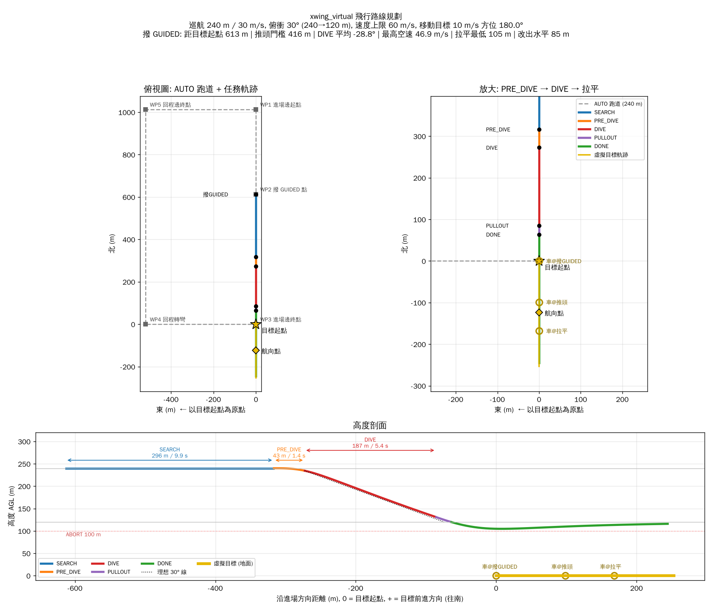

# xwing_virtual — 純虛擬軌跡俯衝版 (無視覺)

> ## ★ 從這裡開始 (2026/10/20)
>
> | 要做什麼 | 看哪份 |
> |---|---|
> | **飛行日** | **`xwing_virtual_prepare_flight.txt`** (實飛 SOP：設定 → 開機 → 指令 → 飛行 → 落地) |
> | 還剩哪些測試 | `xwing_virtual_TEST_CHECKLIST.txt` (第 1–9、11 項已通過；剩第 10 項) |
> | 地面測試指令 | `xwing_virtual_prepare_ground.txt` |
> | 完整說明 (人員、判斷表、緊急處理) | `xwing_virtual_FULL_TEST_PROCEDURE.md` |
> | 測試結果 | `xwing_virtual_TEST_REPORT_20261017.md` (飛機、方向舵)、`xwing_virtual_TEST_REPORT_20261020.md` (雲台) |
> | 雲台介面 / 地面測試細節 | `xwing_virtual_GIMBAL_UART.md`、`xwing_virtual_GIMBAL_GROUND_TEST.md` |
>
> 目前狀態：X-wing 參數、方向舵、整機掛機、雲台整合都通過。目標起點 = 任務規劃 WP4，WP3 切 GUIDED。
> 實飛只要 `python3 xwing_virtual_flight.py --moving --case flight1`。DIVE 一律用方向舵 PID 控制 (版本 A)，`--dive-hold-heading` (版本 B) 已移除 (2026/10/22)。

這一版從原本的 vision_dive (`run_vision_flight.py`) 改出來，條件如下：

| 項目 | 原版 | **xwing_virtual** |
|---|---|---|
| 巡航高度 | 120 m | **240 m** |
| 巡航速度 | 20 m/s (SEARCH 16 m/s) | **30 m/s** |
| 俯衝角 | 25° | **30°** |
| 俯衝高度 | 120 → 70 m | **240 → 120 m** |
| 速度上限 (超速提前拉平) | 30 m/s | **60 m/s** |
| 感知 | 相機 + YOLO + 雲台 (只記錄) + 虛擬目標 (控制) | **控制只用虛擬目標**；對方雲台視覺經 UART 只記錄 |
| 雲台 | 自己控 SIYI (FOLLOW / FPV) | **對方的雲台**：我們依任務狀態送模式鍵 (SEARCH `'1'` 追蹤，**PRE_DIVE `'2'` 鎖定向下 30°**) |
| 目標起點 | (22.913647, 120.312259) | **(23.7214954, 120.3799117)** (2026/10/22；10/19 版為 WP4 23.7217999, 120.3798795) |
| 目標航向點 | (22.9149299, 120.3121517)，方位 355.5° | **(23.7203815, 120.3799117)，方位 180.0° (往南，跟飛機同方向)** |

> **控制邏輯沒有變。** 原版的飛機本來就只吃「虛擬目標」的投影誤差，真實相機和
> YOLO 只負責記錄。所以這一版拿掉整條視覺鏈，飛機的控制路徑還是同一條：
> `MAVROS → 虛擬目標投影 → 狀態機 / PID → AttitudeBridge → 飛控`。
> 改的只有參數、目標座標，以及把視覺硬體從主程式拿掉。



---

## 1. 檔案變更總覽

### 1.1 新增的檔案 (全部以 `xwing_virtual` 命名)

| 新檔案 | 來源 / 對照的原檔 | 內容 |
|---|---|---|
| `xwing_virtual_config.py` | `config.py` | 新任務參數。只留控制需要的參數，視覺、相機、雲台、YOLO、錄影參數全部拿掉 |
| `xwing_virtual_flight.py` | `run_vision_flight.py` | 實飛主程式。拿掉視覺執行緒、相機、雲台、錄影和真實 PID 記錄 |
| `xwing_virtual_common.py` | (新) `run_vision_flight.py` 與 `test_logic_sim.py` 中重複的組裝段落 | 實飛和模擬共用：建虛擬目標、`GuidanceConfig`、bridge 參數覆寫 |
| `xwing_virtual_sim.py` | `test_logic_sim.py` | 任務剖面模擬。改用點質量模型 (含阻力、俯仰速率、過載)，算各段距離 |
| `xwing_virtual_route.py` | (新) | 產生路線圖、Mission Planner 航點、KML |
| `xwing_virtual_route.png` | (產出) | 路線圖：俯視、放大、高度剖面 |
| `xwing_virtual_mission.waypoints` | (產出) | Mission Planner AUTO 跑道 (240 m) |
| `xwing_virtual_route.kml` | (產出) | Google Earth 檢視 |
| `xwing_virtual_route_traj.csv` | (產出) | 模擬軌跡 (含 GPS) |
| `xwing_virtual_README.md` | `README.md` | 本文件 |
| `xwing_virtual_PREFLIGHT_PARAMS.md` | `PREFLIGHT_PARAMS.md` | 飛控參數對齊表 (新數值) |
| `xwing_virtual_RUN_CASES.md` | `RUN_CASES.md` | 到場地執行小抄 (新指令) |
| `xwing_virtual_prepare.txt` | `prepare.txt` | 開機啟動步驟 (最短版 + 指向下面兩份) |
| `xwing_virtual_prepare_flight.txt` | (新) | 實際飛行要輸入的指令 (開機檢查、4 個 case、飛行中訊息、落地後) |
| `xwing_virtual_prepare_ground.txt` | (新) | 地面測試要輸入的指令 (雲台鎖定 A~G、方向舵掛機) |
| `xwing_virtual_FULL_TEST_PROCEDURE.md` | (新) | ★ X-wing 完整測試流程：出發前準備 → 雲台 / 飛機地面測試 → 飛行 → 飛行後 |
| `xwing_virtual_TEST_CHECKLIST.txt` | (新) | 測試總清單 (照順序打勾)；10/17 已完成第 1–6 項 |
| `xwing_virtual_TEST_REPORT_20261017.md` | (新) | ★ 2026/10/17 X-wing 地面測試報告 (參數、方向舵 A/B/E、整機掛機) |
| `test_guided_rearm.py` | (新) | 重複撥 GUIDED 的流程測試 (不需要 ROS)：`python3 test_guided_rearm.py` → PASS |
| `xwing_virtual_PREFLIGHT_REVIEW_20261027.md` | (新) | ★ 週四飛測前總檢查：與原專案的參數差異、驗證狀態、飛前必做 |
| `xwing_virtual_FLIGHT_DAY_QUICK.txt` | (新) | ★ 實飛指令最精簡版 (一頁，當天照抄) |
| `xwing_virtual_FLIGHT_DAY_COMMANDS.txt` | (新) | ★ 實飛當天所有指令 (照順序，可直接複製) |
| `xwing_plot/` | (新) | ★ 飛完畫圖 (全部放這個資料夾, 在裡面執行): |
| `xwing_plot/xwing_plot_report.py` | (新) | 主程式: log → Fig 1~15 (1~9 照學長版面) + report.pdf + summary.txt (自動檢查參數) |
| `xwing_plot/xwing_plot_target_gps.py` | (新) | 虛擬目標 vs 真車 GPS (車子 BIN 放 `xwing_plot/car_bin/` 自動比對) |
| `xwing_plot/test_plot_report.py` | (新) | 不用飛機測試畫圖流程 (`--vision` 加假雲台) |
| `xwing_plot/PLOT_QUICK.txt` | (新) | ★ 實飛畫圖最簡流程 (一頁) |
| `xwing_plot/cut_log.py` | (新) | 大 log 只切出指定趟次並壓成 zip (方便傳檔) |
| `xwing_plot/bin_extract.py` | (新) | 飛控 BIN 只抽出轉彎分析要的資料 (航點、位置、姿態、GPS、空速), 存成小檔 |
| `xwing_plot/PLOT_STEPS.txt` | (新) | ★ 筆電 (Windows) 畫圖步驟: 安裝、拷 log、畫圖指令 (照抄) |
| `xwing_plot/PLOT_GUIDE.md` | (新) | 畫圖詳細說明 (每張圖看什麼、自動檢查門檻、雲台重放) |
| `xwing_virtual_TEST_REPORT_20261020.md` | (新) | ★ 2026/10/20 雲台整合地面測試報告 (模式鍵、鎖定時間、資料鏈) |
| `test_records/20261017_xwing/` | (資料) | 10/17 原始資料：參數檔、方向舵測試 CSV、掛機與實飛指令 log |
| `test_records/20261020_gimbal/` | (資料) | 10/20 原始資料：雲台模式測試 CSV、整機掛機 + 雲台 log；`camera_B/` = 第二台相機 |
| `xwing_virtual_RUDDER_BENCH.md` | (新) | X-wing 方向舵掛機測試流程 |
| `xwing_virtual_GIMBAL_UART.md` | (新) | ★ 對方實驗室雲台視覺 UART 整合說明 (接線、協定、模式鍵對應、待確認問題) |
| `xwing_virtual_GIMBAL_GROUND_TEST.md` | (新) | ★ 雲台鎖定模式地面測試步驟 (桌上自測 → 接線 → 看雲台轉到 −30° → 整機掛機) |
| `xwing_uart_vision.py` | (新) | 背景執行緒接收雲台視覺 UART (v6/v7)、送模式鍵並確認、判斷鎖定到位；視覺資料只記錄，不進控制 |
| `xwing_uart_sender_sim.py` | (新) | 模擬對方 Orin NX + 雲台 (只有 pitch 軸、追蹤 / 鎖定 −30°)，沒有硬體也能測 |
| `xwing_gimbal_mode_test.py` | (新) | 雲台模式鍵地面測試工具 (不需 ROS)：量送出 → 確認 → 鎖定到位的時間 |
| `uart_mipi_receiver.py` | 對方提供 (未修改) | UART 協定定義與獨立接收測試程式 |

### 1.2 沿用、**完全沒改**的原模組

xwing_virtual 直接 import 這四個檔，只用參數覆寫，不改程式碼：

| 檔案 | 作用 |
|---|---|
| `dive_guidance.py` | 狀態機 SEARCH → PRE_DIVE → DIVE → PULLOUT → DONE，以及 DIVE 段 PID |
| `attitude_bridge.py` | 姿態命令 → MAVROS `SET_ATTITUDE_TARGET`、43002 航向、TECS 目標 |
| `virtual_source.py` | 虛擬目標 (靜止 / 移動) 與投影成虛擬畫面 |
| `virtual_target_geom.py` | GPS ↔ NED、落點外插、miss distance |

### 1.3 xwing_virtual **不再使用**的原檔案

這些檔案留在專案裡沒有刪，原版 `run_vision_flight.py` 仍然可以照常跑：

| 類別 | 檔案 |
|---|---|
| 相機 / YOLO / DKF | `vision.py`, `vision_driver_car_dive_with_dkf_v3.py`, `dkf_tracker_gimbal.py`, `ray_projection_distance.py`, `cameras.py` |
| 雲台 | `gimbal.py`, `siyi_sdk.py`, `siyi_message.py`, `crc16_python.py`, `utils.py` |
| 真實影像 PID 記錄 | `realvision_pid_logger.py`, `gimbal_pid_compensation.py`, `attitude_time_history.py` |
| 錄影 | `video_writer.py` |
| 視覺後處理 | `postprocess_compare.py`, `car_track.py` |
| 視覺 / 雲台測試 | `test_camera_bench.py`, `test_gimbal.py`, `test_dive_ground.py` |
| 其他 | `check_version.py` (檢查原版檔案指紋) |

> `test_rudder_bench.py` 只測方向舵映射、與視覺無關，xwing 機若換了機身仍可拿來掛機驗證。

---

## 2. 參數對照 (`config.py` → `xwing_virtual_config.py`)

### 2.1 有改的參數

| 參數 | 原值 | 新值 | 原因 |
|---|---|---|---|
| `CRUISE_AGL_M` | 120 | **240** | 需求 |
| `DIVE_ANGLE_DEG` | 25 | **30** | 需求 |
| `PULLOUT_AGL_M` | 70 | **120** | 需求：俯衝 240 → 120 m |
| `TECS_HOLD_ALT_M` | 70 | **120** | 拉平後保持在拉平高度 |
| `V_CRUISE_MPS` | 20 | **30** | 需求 (也就是 bridge 的 `V_REF_MPS`) |
| `SEARCH_SPEED_MPS` | 16 | **30** | 必須等於 AUTO 巡航，撥 GUIDED 才不會加減速 |
| `TECS_SPEED_MPS` | 18 | **30** | 拉平後回巡航速度 |
| `PULLOUT_VMAX_MPS` | 30 | **60** | 需求：速度上限。舊值 30 會讓飛機一進 DIVE 就判定超速 |
| `PREDIVE_DIST_M` (移動) | 257 | **415.69** | = 240 / tan30°，由 `CRUISE_AGL_M` / `DIVE_ANGLE_DEG` 直接算出，見 4.3 |
| `STATIC_PREDIVE_DIST_M` (靜止) | 257 | **415.69** | 與移動版相同 |
| `ABORT_MIN_AGL_M` | 55 | **100** | 拉平高度上移，安全底線跟著上移 |
| `ENTRY_MIN_AGL_M` | 60 (寫死在主程式) | **200** (移到 config) | 240 m 進場時，若低於 200 m 代表幾何已經不對，不准推頭 |
| `ALPHA_NOM_DEG` | 3.5 | **1.6** | 升力 ∝ V²，3.5 × (20/30)² ≈ 1.6。SEARCH 的 pitch 交給 TECS，這個值只會進 log |
| `RUDDER_VSCHED` | `((999, 1.0),)` 不排程 | `((999, 1.0),)` **與原版相同** | 2026/10/22 與老師討論後改回原值 (曾改成依 (30/V)² 縮小權限)。方向舵其餘增益也全部與原版相同 |
| `MOVING_START_GPS` | (22.913647, 120.312259) | **(23.7214954, 120.3799117)** | 新場地 (2026/10/22) |
| `MOVING_HEADING_GPS` | (22.9149299, 120.3121517) | **(23.7203815, 120.3799117)** | 起點正南 124 m (方位 180°) |
| `TARGET_GPS` (靜止) | (22.913677, 120.312260) | **= 目標起點** | 新場地 |
| `GIMBAL_FPV_SETTLE_S` | 0.3 | **0** | 沒有實體雲台要切 FPV，DIVE 當拍就開始 PID |

### 2.2 新增的參數

| 參數 | 值 | 說明 |
|---|---|---|
| `MOVING_STOP_AT_HEADING_GPS` | `False` | 起點到航向點只有 **124 m**，10 m/s 只要 12.4 s 就走完。`False` 表示虛擬目標過了航向點繼續沿同方位前進 (與原版行為相同)；`True` 表示停在航向點 |
| `PREDIVE_TIMEOUT_S` | 45 | 原本是 `dive_guidance` 預設值，移到 config |

### 2.3 沿用不變的參數

PID 增益 (`PID_LAT_*`、`PID_LON_*`)、方向舵限幅 `RUDDER_LIMIT_DEG=30`、`K_LAT_TO_RUDDER`、
roll 保護、虛擬相機內參 (1x)、`TARGET_SPEED_MPS=10`、`MOVING_TARGET_LEAD=False`、
`THR_TRIM/MIN/MAX`、`PREDIVE_HANDOFF_PITCH_TOL_DEG=3`。

> ⚠ **`THR_TRIM=0.45` 是 20 m/s 的配平油門**，30 m/s 需要更多油門。請填飛控在 AUTO 30 m/s
> 巡航時的 `TRIM_THROTTLE`/100。這個值只影響 PRE_DIVE 推頭那約 1.4 秒的油門。

### 2.4 刪掉的參數 (視覺專用)

`ZOOM_LEVEL`、`FX/FY/CX/CY` 以外的相機設定、`YOLO_*`、`CAPTURE_LATENCY_MS`、`CAM_*`、
`GCOMP_*`、`REALVISION_PID_*`、`SIYI_*`、`GIMBAL_*`、`GATE_*`、`ACQUIRE_*`、
`TRACK_GATE_*`、`VIDEO_FPS`。

---

## 3. 主程式對照 (`run_vision_flight.py` → `xwing_virtual_flight.py`)

| 項目 | 原版 | xwing_virtual |
|---|---|---|
| 執行緒 | 視覺 (~30 Hz) + 控制 (50 Hz) + 取像 + 錄影 ×2 | **只有控制 (50 Hz)** (加上 bridge 自己的發送執行緒) |
| 硬體需求 | ROS + MAVROS + 相機 + SIYI 雲台 + GPU (YOLO) | **ROS + MAVROS + numpy**；接對方雲台時再加 USB-UART + pyserial (辨識在對方的 Orin NX 上跑) |
| 啟動檢查 | 雲台連線失敗或取像失敗 → FATAL 結束 | 拿掉；**新增飛控空速參數檢查** (`AIRSPEED_MIN/MAX/CRUISE`，新舊參數名都查) |
| 控制輸入 | `virt.get_fields()` → `sm.update()` | **相同** |
| 真實 PID 記錄 | `GimbalCompPIDLogger` 每拍算兩套真實 PID | 拿掉 |
| 掛機合成 bbox (`--inject-bbox`) | 有 | 拿掉 (虛擬目標本身就是合成的) |
| 輸出 | 主 CSV + 視覺 CSV + 標註影片 + raw 影片 + events | **主 CSV + events** |
| 主 CSV 欄位 | 160 欄 (含 real_*、gcomp_*、vis_*)，另有視覺 CSV 54 欄 | 80 欄 + 雲台 UART 34 欄 (`vis_*`、`gimbal_*`，沒接雲台時留空)。拿掉 `frame_idx`、`img_to_cmd_ms`、`real_*`、`gcomp_*`；**新增 `tgt_lat`、`tgt_lon`** (虛擬目標當下 GPS，方便在地圖上畫) |
| 檔名 | `flight_YYYYmmdd_HHMMSS_<tag>.csv` | `xwing_virtual_YYYYmmdd_HHMMSS_<tag>.csv` |
| 命令列 | `--static/--moving/--start/--speed/--target/--predive-dist/--bench/--bench-pitch/--bench-dive/--ground-test/--case/--tgt-heading/--no-video/--no-annot/--inject-*` | 同左，但拿掉 `--no-video`、`--no-annot`、`--inject-*`、`--predive` |
| `BENCH_GEOMETRY_AGL_M` | 寫死 120 | `= CRUISE_AGL_M` (240) |

---

## 4. 任務各段距離 (★ 你要的計算)

### 4.1 純幾何 (理想、瞬間推頭)

| 量 | 算式 | 值 |
|---|---|---|
| 推頭點到目標的水平距 | 240 / tan30° | **415.7 m** |
| DIVE 水平距 | (240 − 120) / tan30° | **207.8 m** |
| DIVE 斜距 (航跡長) | (240 − 120) / sin30° | **240.0 m** |
| 拉平時到目標的水平距 | 120 / tan30° | **207.8 m** |
| DIVE 時間 (若維持 30 m/s) | 240 / 30 | 8.0 s |

### 4.2 模擬結果 (實際會飛的樣子)

用 `xwing_virtual_sim.py` 跑，狀態機與實飛同一套。模型設定：L/D = 8、pitch 速率 20°/s、
過載 2.5 g；撥 GUIDED 時飛機在目標起點後方 **613 m** (任務規劃 WP3 → WP4，2026/10/19)。

**移動目標** (10 m/s 往南，飛機從北邊追擊)：

| 段 | 時長 | **水平距離** | 航跡長 | 高度 | 空速 | 到目標水平距 |
|---|---|---|---|---|---|---|
| **SEARCH** | 9.9 s | **296 m** | 296 m | 240 → 240 m | 30 → 30 m/s | 613 → 416 m |
| **PRE_DIVE** | 1.4 s | **43 m** | 44 m | 240 → 235 m | 30 → 31.6 m/s | 416 → 387 m |
| **DIVE** | 5.4 s | **187 m** | 213 m | 234 → 131 m | 31.6 → 45.8 m/s | 386 → 254 m |
| PULLOUT (交棒 0.5 s) | 0.5 s | 21 m | 23 m | 131 → 120 m | 45.9 → 46.6 m/s | 254 → 238 m |
| 拉平改出 (到航跡角 ≥ −2°) | 1.9 s | 85 m | — | 最低 **105 m** | ~47 m/s | — |
| **合計 (撥 GUIDED → 改平)** | ~19 s | **~630 m** | | | | |

**靜止目標** (固定在起點)：

| 段 | 時長 | **水平距離** | 航跡長 | 高度 | 空速 | 到目標水平距 |
|---|---|---|---|---|---|---|
| **SEARCH** | 6.6 s | **197 m** | 197 m | 240 → 240 m | 30 → 30 m/s | 613 → 416 m |
| **PRE_DIVE** | 1.4 s | **43 m** | 44 m | 240 → 235 m | 30 → 31.6 m/s | 416 → 372 m |
| **DIVE** | 5.0 s | **166 m** | 195 m | 234 → 133 m | 31.6 → 46.4 m/s | 372 → 206 m |
| PULLOUT | 0.5 s | 20 m | 24 m | 132 → 120 m | 46.4 → 47.5 m/s | 205 → 185 m |
| 拉平改出 | 2.2 s | 97 m | — | 最低 **97 m** | ~48 m/s | — |

**SEARCH 的長度由「在哪裡撥 GUIDED」決定**：

| 撥 GUIDED 時距目標起點 | 移動 SEARCH | 靜止 SEARCH |
|---|---|---|
| 600 m | 276 m / 9.2 s | 184 m / 6.1 s |
| **613 m (目前任務規劃 WP3)** | **296 m / 9.9 s** | **197 m / 6.6 s** |
| 700 m | 426 m / 14.2 s | 284 m / 9.5 s |
| 800 m | 576 m / 19.2 s | 384 m / 12.8 s |
| 1000 m | 876 m / 29.2 s | 584 m / 19.5 s |

算式：移動版 SEARCH 水平距 = 30 × (D_guided − 415.69) / (30 − 10)，靜止版 = D_guided − 415.69。
建議 SEARCH 至少 8–10 s，讓 43002 航向和 TECS 先穩定。

### 4.3 推頭距離 = 240 / tan30° = 415.69 m

`PREDIVE_DIST_M` 與 `STATIC_PREDIVE_DIST_M` 都用純幾何值，在 `xwing_virtual_config.py` 裡直接寫成
`CRUISE_AGL_M / tan(DIVE_ANGLE_DEG)`。改巡航高度或俯衝角，推頭距離會自動跟著變。

實際平均俯衝角會跟 30° 差約 1°，模擬結果如下：

| 目標 | DIVE 平均航跡角 | 原因 |
|---|---|---|
| 移動 | **≈ −28.8°** (略淺) | 從後方追車，車往前跑，視線越來越淺，PID 把俯衝跟著拉淺 |
| 靜止 | **≈ −31.1°** (略陡) | 推頭需要約 1.4 s，期間水平多飛 43 m、只掉 5 m |

`python3 xwing_virtual_sim.py --sweep` 可以掃 380–480 m 看每個門檻的平均俯衝角
(每 10 m 約差 0.6°)。實飛後看 log 的 `glide_slope_err_deg`，若想修正，可用
`--predive-dist` 臨時覆寫：平均比 −30° 陡就加大，淺就減小。

### 4.4 速度與高度 (⚠ 一定要看)

| 情境 | DIVE 末速 | 最高空速 | 拉平後最低高度 |
|---|---|---|---|
| 有阻力 (L/D = 8) | 46 m/s | 47–48 m/s | **~97–105 m** |
| 無阻力 (上界) | ~55 m/s | 61–63 m/s | **~86–97 m** |

1. **拉平門檻是 120 m，但飛機會往下沉到約 100 m 才改平。** 從 ~47 m/s、−30° 拉回平飛需要
   約 2 s、85–97 m 水平距離。如果 **120 m 是不能低於的底線**，請把 `PULLOUT_AGL_M` 改成
   **~140 m** (`TECS_HOLD_ALT_M` 可以維持 120)。
2. 正常剖面不會碰到 60 m/s。60 m/s 的超速拉平是安全網。如果 **60 m/s 是機體結構極限**，
   拉平過程速度還會再漲 2–3 m/s，建議把 `PULLOUT_VMAX_MPS` 降到 **55**。
3. 這些數字來自點質量估算模型。L/D、pitch 速率、過載都是假設值，請以實飛 log 為準。

### 4.5 移動目標的 miss

前置瞄準 (`MOVING_TARGET_LEAD`) 維持關閉 (跟原版一樣)。飛機一直瞄車的「當下位置」，
拉平瞬間沿速度外插的落點會落在車後方 **約 70 m** (靜止目標約 2 m)。
模擬打開前置瞄準時，miss 約 6 m，但俯衝會變淺到約 −23°。原版關掉前置瞄準是因為真實相機
視野會丟車，純虛擬沒有這個限制；要打開的話，請同時調小 `PREDIVE_DIST_M`，並先用模擬確認。

---

## 5. 飛行路線規劃


### 5.1 進場方式 (2026/10/19 任務規劃)

目標從 WP4 **往南** (180°) 走，飛機**從北邊往南**進場 (同向追擊)。

```
   WP1 ─────────── WP2 (轉彎點)
    │                │  約 400 m (轉彎後穩定)
    │               WP3 ★ 地面站切 GUIDED
    │                │  約 613 m
   WP6              │
    │                │
   WP5 ─────────── WP4 ◎ 目標起點 (車往南開)
```

### 5.2 航線

**實際飛行以 Mission Planner 裡的任務為準** (WP1–WP6 + DO_JUMP)。
`xwing_virtual_mission.waypoints` 是程式依同樣的距離產生的參考航線：

| 本檔航點 | 對應任務規劃 | 位置 | 緯度, 經度 |
|---|---|---|---|
| WP1 進場邊起點 | ≈ WP2 轉彎點 | 目標起點北方 1013 m | 23.7305953, 120.3799117 |
| **WP2 撥 GUIDED 點** | **= WP3** | 目標起點北方 613 m | **23.7270021, 120.3799117** |
| WP3 進場邊終點 | = WP4 目標起點 | 目標起點 | 23.7214954, 120.3799117 |
| WP4 回程轉彎 | ≈ WP5 | 目標起點往西 520 m | 23.7214954, 120.3748094 |
| WP5 回程邊終點 | ≈ WP6 / WP1 | 北方 1013 m、往西 520 m | 23.7308998, 120.3747772 |
| DO_JUMP → WP1 | | 無限繞 | |

- 轉彎點後 400 m 才切 GUIDED：上次 X-wing log 轉彎後約 320–380 m 才完全穩定。
- ★ **起飛、降落航點請自己加在前後** (X-wing `Q_ENABLE = 0`，不是 VTOL)。

### 5.3 任務關鍵點 (移動目標，模擬)

| 事件 | 時間 | 飛機位置 | AGL | 車的位置 |
|---|---|---|---|---|
| 撥 GUIDED (任務開始) | 0 s | 23.7270021, 120.3799117 (WP3，目標起點北 613 m) | 240 m | WP4 起點 |
| PRE_DIVE 推頭 | 9.9 s | 23.7243395, 120.3799117 (起點北 317 m) | 240 m | 起點南 99 m |
| DIVE 開始 | 11.3 s | 23.7239453, 120.3799117 (起點北 273 m) | 234 m | 起點南 113 m |
| PULLOUT 拉平 | 16.8 s | 23.7222618, 120.3799117 (起點北 85 m) | 131 m | 起點南 168 m |
| 改平 (航跡角 ≥ −2°) | 約 18.7 s | 約在起點正上方 | ~105 m | 起點南 ~187 m |

靜止目標：SEARCH 只有 6.6 s (飛機 30 m/s 直接接近)，比建議的 8–10 s 短；飛靜止版時 GUIDED 要再早約 100 m 切。

### 5.4 車子 (真實目標) 的起步方式

虛擬目標在**切 GUIDED 那一刻**從 WP4 以 10 m/s 往南走。車子要在那一刻**已經**以 36 km/h 通過 WP4：

| 起步時機 | 車子起點 | 說明 |
|---|---|---|
| **飛機通過 WP2 轉彎點時** (建議) | **WP4 北方約 95 m** | 轉彎點 → WP3 約 11–13 s (上次 log)；車 5 s 加速到 36 km/h 後定速 |
| 切 GUIDED 前 5 s (地面站倒數) | WP4 北方約 25 m | 只算加速距離 |

- 通用公式：車子起點 ≈ 10 × T − 5 × (加速秒數)，T = 飛機通過轉彎點到切 GUIDED 的秒數。
- 時間誤差 1 s ≈ 位置差 10 m，只影響雲台畫面，飛機控制用虛擬目標。
- WP4 以南要有約 250 m 的路可以開。

拉平之後，飛機以 TECS 120 m / 30 m/s 往南直飛。之後撥回 AUTO，飛機會回到跑道 (爬回 240 m)。

> **車的位置注意**：撥 GUIDED 後 12.4 s 車就走到航向點，PRE_DIVE 時已經過了航向點 (預設
> `MOVING_STOP_AT_HEADING_GPS=False`，沿同方位繼續走)。若要車停在航向點，改成 `True`，
> 再跑一次 `xwing_virtual_sim.py --sweep` 重新校推頭距離 (車停下來等於變成靜止目標，
> 平均俯衝角會接近靜止目標的 ≈ −31°)。

---

## 6. 使用方式

```bash
# 1. 在家: 模擬 + 產生路線圖與航點 (不需要 ROS)
python3 xwing_virtual_sim.py                  # 移動目標各段距離
python3 xwing_virtual_sim.py --static
python3 xwing_virtual_sim.py --sweep          # 掃推頭距離
python3 xwing_virtual_route.py                # 路線圖 + .waypoints + .kml

# 2. 機上 (ROS + MAVROS)
roslaunch mavros apm.launch
python3 xwing_virtual_flight.py               # 移動目標
python3 xwing_virtual_flight.py --static      # 靜止目標
```

場地執行步驟見 `xwing_virtual_RUN_CASES.md`，飛控參數見 `xwing_virtual_PREFLIGHT_PARAMS.md`。

---

## 7. 驗證狀況

| 項目 | 結果 |
|---|---|
| `xwing_virtual_sim.py` 移動 / 靜止 | 完整跑完 SEARCH → PRE_DIVE → DIVE → PULLOUT → DONE |
| `xwing_virtual_flight.py` | 用假的 rospy/MAVROS (無 ROS 環境) 把模擬軌跡回放進主迴圈：移動、靜止都正確走完 5 個模式，`errors=0`，CSV 正常寫出，miss 與模擬一致 (68.0 m / 1.7 m) |
| 原版檔案 | 沒有修改 |
| **尚未做** | 沒有在真的 ROS / MAVROS / 飛控 / 飛機上跑過。PID 增益在 ~50 m/s 俯衝下沒有實測。L/D、俯仰速率等模型參數是假設值 |
