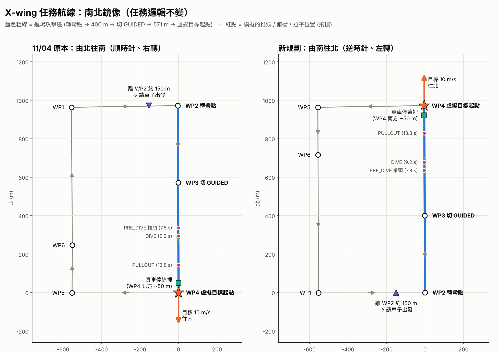

# X-wing 任務改成「由南往北」攻擊 — 規劃 (2026/11/10)

> 任務邏輯完全不變，只是把整個任務**南北鏡像**：
> 同一個矩形航線、同樣的距離 (轉彎點 → 400 m → 切 GUIDED → 571 m → 虛擬目標起點)、
> 同樣的叫車時機 (離轉彎點 150 m)、同樣的車子位置 (目標起點後方 50 m)。



---

## 1. 改了什麼 / 沒改什麼

| 項目 | 11/04 (由北往南) | **新版 (由南往北)** |
|---|---|---|
| 繞圈方向 | 順時針 | **逆時針** |
| 轉彎點 WP2 | 東北角，**右轉**往南 | **東南角，左轉往北** |
| 切 GUIDED WP3 | 轉彎點南方 400 m | **轉彎點北方 400 m** |
| 虛擬目標起點 WP4 | 東南角，往南 180° | **東北角，往北 0°** |
| 真車停的位置 | WP4 北方約 50 m，車頭朝南 | **WP4 南方約 50 m，車頭朝北** |
| 請車子出發 | WP1→WP2 (北邊往東) 離 WP2 約 150 m | **WP1→WP2 (南邊往東) 離 WP2 約 150 m** |
| 拉平後飛機去哪 | 往南越過東南角 | **往北越過東北角** |
| 推頭距離、俯衝角、拉平高度、速度、雲台模式鍵 | — | **都不變** |

---

## 2. Mission Planner 任務 (直接載入)

檔案：**`xwing_virtual_mission_S2N_20261110.waypoints`** (Mission Planner → 讀取航點檔)

四個角沿用 11/04 任務的座標，只是順序反過來；WP3、WP6 用同樣的距離鏡像算出。

| # | 命令 | 位置 | 緯度 | 經度 | 高度 | 下一段 |
|---|---|---|---|---|---|---|
| 1 | WAYPOINT | 西南角 (11/04 的 WP5) | 23.7222320 | 120.3744560 | 240 | 往東 553 m |
| **2** | WAYPOINT | **東南角 = 轉彎點** (11/04 的 WP4) | 23.7222419 | 120.3798848 | 240 | **左轉**往北 401 m |
| **3** | WAYPOINT | **切 GUIDED 點** | **23.7258416** | **120.3798693** | 240 | 往北 571 m |
| **4** | WAYPOINT | **東北角 = 虛擬目標起點** (11/04 的 WP2) | **23.7309736** | **120.3798473** | 240 | 往西 553 m |
| 5 | WAYPOINT | 西北角 (11/04 的 WP1) | 23.7308950 | 120.3744239 | 240 | 往南 247 m |
| 6 | WAYPOINT | 西北角南方 247 m | 23.7286751 | 120.3744321 | 240 | 往南 717 m |
| 7 | DO_JUMP | 回 WP1，重複 3 次 (照 11/04 任務的設定) | | | | |

- 高度都是 Relative 240 m。
- 檔案第 0 列 (home) 只是佔位，連上飛機後以飛機的 home 為準。
- ★ 起飛、降落航點照平常方式自己加在前後 (X-wing 不是 VTOL)。
- 載入後請在地圖上確認：WP2→WP3→WP4 是**東邊那條路**往北、WP1→WP2 是**南邊**往東。

---

## 3. 程式設定 (已改好)

`xwing_virtual_config.py`：

```python
MOVING_START_GPS   = (23.7309736, 120.3798473)   # WP4 東北角 = 虛擬目標起點
MOVING_HEADING_GPS = (23.7320875, 120.3798473)   # 起點正北 124 m → 方位 0.0° (往北)
```

實飛指令**不變**：`python3 xwing_virtual_flight.py --moving --case flight1`
(不要加 `--start` / `--tgt-heading`)。

**開機一定要看到：**
```
[xwing] 移動目標: 起點 (23.7309736, 120.3798473) 方位 0.0° 速度 10.0 m/s ...
```
如果還是 `方位 180.0°` 或起點 23.7222419 → 程式不是最新版，**不要飛**。

改回由北往南：把上面兩行換回 `(23.7222419, 120.3798848)` / `(23.7211280, 120.3798848)`，
任務檔用 11/04 的版本。

撥 GUIDED 時的檢查 (離起點 486~1500 m、起點在機頭 ±45° 內) 都是相對的，方向反過來不用改。

---

## 4. 一趟的流程與時間

### 4.1 撥 GUIDED 之前

| 步驟 | 飛機 | 地面 |
|---|---|---|
| 1 | AUTO 240 m，**先繞一圈不切 GUIDED** | 確認 WP2 **左轉**後有對正往北、`VIS link=1` |
| 2 | WP1→WP2 (南邊往東)，**離 WP2 約 150 m** (約 23.7222419, 120.3784130) | **喊車子出發** (車在 WP4 南方 50 m，約 23.7305244, 120.3798473，車頭朝北) |
| 3 | 在 WP2 左轉往北，對正 | — |
| 4 | **到 WP3** | 地面站 **Set Mode GUIDED** (數傳延遲 0.5~1 s，可稍提早) |

叫車到切 GUIDED 的時間跟 11/04 一樣 (幾何完全鏡像)，車子的起步時機不用重新抓。

### 4.2 撥 GUIDED 之後 (模擬，移動目標)

| 撥 GUIDED 後 | 事件 | 飛機位置 | AGL | 虛擬目標 |
|---|---|---|---|---|
| 0 s | `★ GUIDED 上升沿`，雲台 `'1'` 追蹤 | WP3，起點南 571 m | 240 m | WP4 起點 |
| 7.8 s | `SEARCH → PRE_DIVE` 推頭，雲台 `'2'` 鎖 −30° | 起點南 337 m | 240 m | 起點北 78 m |
| 9.2 s | `PRE_DIVE → DIVE` 30° 俯衝 | 起點南 294 m | 234 m | 起點北 92 m |
| 13.8 s | `DIVE → PULLOUT` 拉平 | 起點南 143 m | 151 m | 起點北 138 m |
| 14.3 s | `PULLOUT → DONE` 平飛往北 | 起點南 122 m | 140 m | — |
| 約 16 s | 改平 (最低約 124 m) | 起點南約 60 m | ~124 m | 起點北 ~160 m |

看到 `PULLOUT → DONE` 後地面站切回 **AUTO**：飛機回到任務 (往 WP4 → 西轉)，爬回 240 m。

---

## 5. ★ 到場要確認的事 (方向反過來才會出現的)

1. **東北角以北的路**：真車從 WP4 南方 50 m 往北開，要能**穿過東北角路口再往北開約 250~300 m**
   (11/04 是東南角以南)。路口要有人看車，車子不要為了等飛機在路口停。
2. **拉平後的空域**：飛機拉平時在東北角南方約 140 m、改平最低約 124 m，之後**往北飛越東北角**。
   確認東北角北邊沒有高的障礙物 (建物、電線、溫室支架) 和人群，也在可飛範圍內。
3. **左轉**：11/04 是右轉進場，這次在東南角左轉。先繞一圈看轉完到 WP3 有沒有對正
   (10/29 轉彎後約 10~13 s、300~400 m 才對正)；沒對正就不要在這圈切 GUIDED。
4. **風向**：10/29 是西北風 5~8 m/s。往北飛會變成**逆風進場**，地速變慢 (約 24~27 m/s)，
   SEARCH 會多幾秒、俯衝相對地面會比較陡；拉平後也是逆風，改出距離比較短。
   程式用相對距離觸發，不用改參數；回來看 log 的 `glide_slope_err_deg`。
5. **遙控 / 數傳距離**：10/29 的 RC 失控保護多發生在離飛手最遠的轉彎點附近。
   新的轉彎點在東南角、俯衝在東北角，請依飛手站的位置確認兩處的 RC / 數傳訊號。

---

## 6. 分析工具

- `xwing_plot_report.py` / `xwing_plot_target_gps.py`：已改成跟著目標方位算前後差，往北也正確
  (Fig 14 summary 寫「沿目標方位的前後差」，負 = 車子落後)。
- `test_records/20261104_xwing_flight/turn_plot.py`、`car_vs_virtual.py` 是 11/04 (往南) 專用的分析，
  新方向的資料要另外改 (轉彎改看左轉、車子改看往北)。
- 路線圖：`python3 xwing_virtual_route.py --approach 972 --guided-dist 571 --side-dist 553 --side west`
  會依新的 config 產生 `xwing_virtual_route.png` / `.kml` (參考用)。

---

## 7. 已驗證

| 項目 | 結果 |
|---|---|
| `xwing_virtual_route.py` 模擬 (往北) | PRE_DIVE 7.8 s、DIVE 9.2 s、PULLOUT 13.8 s，平均俯衝 −28.8°，最低 124 m (與往南版相同) |
| `test_guided_rearm.py` (重複撥 GUIDED) | PASS，航向命令 0° |
| `xwing_plot/test_plot_report.py --vision` (完整飛行程式 + 畫圖) | 跑完，成績與往南版完全一樣 (鏡像)，Fig 14 前後差方向正確 |
| `test_logic_sim.py` | 狀態機順序正常 |
